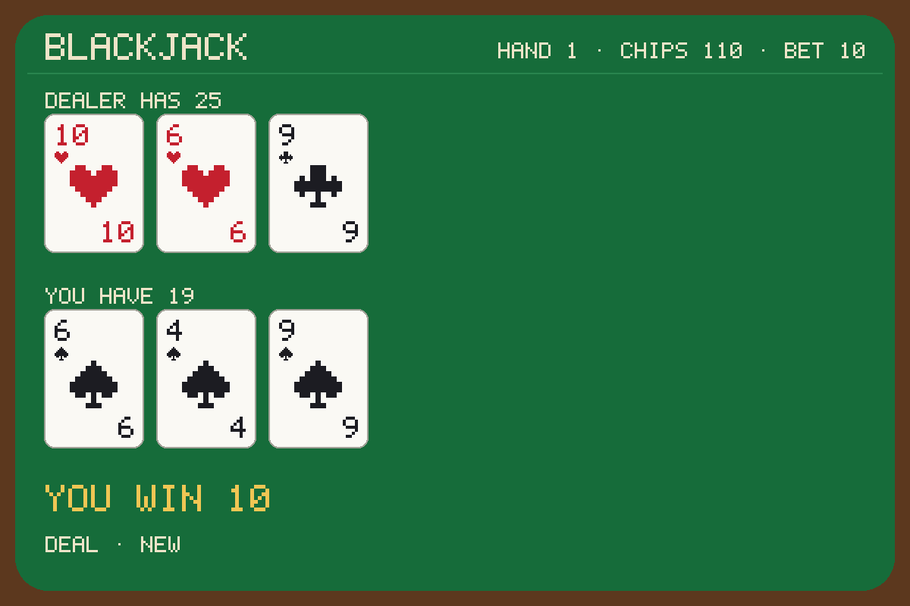

# BlackjackAgent



Play blackjack in Craft, a move at a time. Say `$blackjack deal`, and the dealer deals: your two cards, the dealer's
up card and one face down. Say hit, stand or double; the dealer plays out the hand and pays you. The table comes back
in the chat as cards drawn in text, and as a picture that Canvas shows beside it.

## What you can ask

```
$blackjack deal #canvas
$blackjack deal me in for 25
$blackjack hit
$blackjack stand
$blackjack double down
$blackjack new table with 500 chips
```

In the Craft app, `#canvas` opens the pane that shows the pictures a session writes, so the table appears beside the
chat; once it is open it stays open, and each move redraws it.

## What you get

- **A real game.** One deck, shuffled again when it runs low; the dealer stands on every 17; blackjack pays 3 to 2; you
  can double on your first two cards. Your chips carry from hand to hand, and you start with 100.
- **The table in the chat.** Every card drawn in text, the dealer's hole card face down until the hand ends, what just
  happened, and the moves you can make next.
- **The table as a picture.** `blackjack/table.png` in your project, redrawn every move, for Canvas.
- **No made-up cards.** Every card comes off the shoe in order, and the hole card never leaves the agent while the hand
  is in play. A `seed` fixes the shuffle, so a game plays again card for card.
- **The game in the picture.** The table's state rides inside the PNG, so the next move plays on from it, and a table
  can be picked up again later.

## How it works

- Each move is one call, in a process of its own, released when it has answered. No model is asked.
- A move that cannot be made now is refused with a sentence that says what to do instead: a hit with no hand in play,
  a bet over your chips, a double after you have hit, or a move it does not know.
- It is the first Python agent on [GranitePython](https://github.com/riteshpakala/GranitePython), the Python port of
  Granite's agent kernel and its standard. A Craft host calls it exactly as it calls a Swift or Rust agent.

## Get it

Installing a Python repository from Craft itself, and listing it in the Agent Store, come with Craft's Python install
path. Until then, install it with GranitePython's installer onto a shelf, and run Craft with `CRAFT_AGENTS_DIR` naming
that shelf, which Craft then reads in place of its own (`~/.rao/apps/craft/agents`):

```bash
granite agents add https://github.com/rao-craft/BlackjackAgent.git --shelf <shelf>
CRAFT_AGENTS_DIR=<shelf> craft agents      # lists blackjack
```

Then say `$blackjack deal #canvas` in a session.

## Requirements

- macOS 14 or later, or Linux; Python 3.11 or later, and GranitePython's installer, which bundles the agent into one
  file run by the Python that installed it. Nothing else: the agent uses Python's standard library alone.
- The source is MIT. The runner carries GranitePython, which is GPL-3.0, so an installed `blackjack` runner is a
  GPL-3.0 combined work.

## For developers

What a call takes and answers, the table and the state it carries, how a host runs it, and how to build, test and play
it without Craft are in the [reference](Docs/Reference.md), which also writes up the change Craft would need for an
agent to open Canvas itself. The agent standard it follows is [Schema/Blackjack.md](Schema/Blackjack.md), its copy of
Craft's agent standard; how it is tested, and what each run found, is [TESTING.md](TESTING.md).
