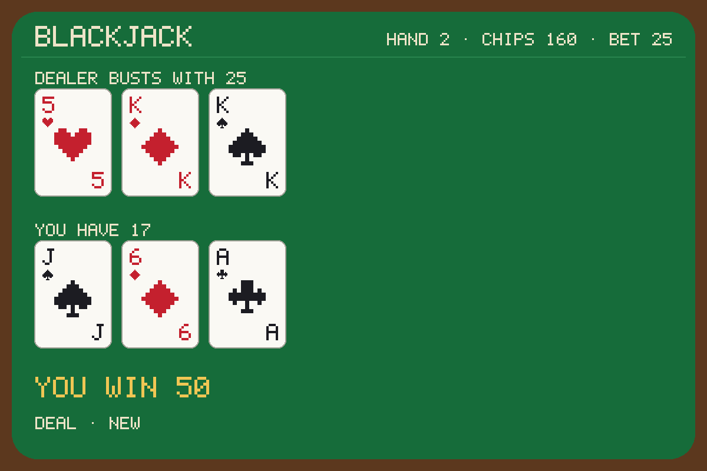

# Testing blackjack

How `blackjack` is tested, and what each run found. Newest first.

## 2026-11-10: the first version, on GranitePython aaa2a8c



Run on macOS 27.0.1 (arm64) with Python 3.12.8, and in Apple `container` 1.6.1 (Linux arm64, `python:3.12-slim-bookworm`,
Python 3.12.16). Craft was not run: its machine's GPU was in use for another job, and blackjack asks no model, so
nothing here needs it. How to run it in Craft is at the end.

### The suite

`python -m unittest`: 14 tests, all passing, on Python 3.11 and 3.12.

| File | Tests | What they hold |
| --- | --- | --- |
| `tests/test_game.py` | 10 | totals hard and soft; a seed's shuffle; a hand played through and paid; the dealer standing on a soft 17; blackjack at 3 to 2, two blackjacks pushing, the dealer's blackjack; a double, a bust, a 21 standing by itself, a push; every move that cannot be made, in its sentence; the shoe shuffled again when low; the state read back |
| `tests/test_agent.py` | 4 | a hand dealt, hit, shown and stood through `granite.perform`, the hole card in no answer, every screen line inside 60 columns, the picture's size and the state it carries; a new table kept elsewhere; every refusal by kind; the entry, and the input schema kept beside it |

### GranitePython's check, on this Mac (`scripts/check.sh --native`)

Installed from this repository's last commit by GranitePython's installer, then called as a host calls it, the five
fixtures in `Schema/examples/` in name order in one folder:

```text
installed BlackjackAgent: blackjack · granite 0.1.0@15c65dac01db
valid: installation.json against granite-agent-installation.schema.json
valid: entry-0.json against granite-agent-entry.schema.json
note: drew the table to blackjack/table.png
released · peak 36 MB · 0.1 s CPU in 0.1 s
valid: 1-deal.perform.answer.json against granite-agent-answer.schema.json
valid: 1-deal.perform.answer.json against craft-agent-output.schema.json
…
note: the dealer turns 6♥
note: the dealer draws 9♣
1-deal.perform: answered, table table (written)
2-hit.perform: answered, table table (rewritten)
3-stand.perform: answered, table table (rewritten)
fold.refusal: refused (input): blackjack could not read its input: unknown variant `fold`, expected one of `deal`, `hit`, `stand`, `double`, `show`, `new`
hit-after-the-hand.refusal: refused (call): no hand is in play to hit: say deal to start one
== check passed: BlackjackAgent, 5 calls (native)
valid: 1-deal.perform.answer.json against blackjack.answer.schema.json (and 2-hit, 3-stand)
seed 3: 6♠ 4♠ against 10♥ and a hidden card; 9♠ for 19; the dealer busts with 25; 110 chips
the table is 1200x800, 12594 bytes, and carries the hand it shows
blackjack: check passed (native)
```

### GranitePython's check, in Apple's container (`scripts/check.sh`)

The same, installed and called inside Linux: the same answers, and the same picture, byte for byte (12594 bytes).
The first container run found a bug in GranitePython's check, not in blackjack: it did not resolve a relative path in
`paths` against the call's folder inside a container (the parrot writes no file, so its run never reached it). Fixed
in GranitePython aaa2a8c; the run after it:

```text
installed BlackjackAgent: blackjack · granite 0.1.0@aaa2a8c96909
note: drew the table to blackjack/table.png
released · peak 30 MB · 0.1 s CPU in 0.1 s
…
1-deal.perform: answered, table table (written)
2-hit.perform: answered, table table (rewritten)
3-stand.perform: answered, table table (rewritten)
fold.refusal: refused (input): …
hit-after-the-hand.refusal: refused (call): no hand is in play to hit: say deal to start one
== check passed: BlackjackAgent, 5 calls (container)
blackjack: check passed (container)
```

### The public repository, in Apple's container

`containers/check.sh https://github.com/rao-craft/BlackjackAgent.git` from GranitePython, after the push: the container
fetched `main` (7e159dc) from GitHub itself, installed it and made the five calls. Check passed, 5 calls.

### A game in the terminal, in Apple's container (`scripts/play.sh --container --seed 3`)

The runner installed in the container by GranitePython's installer, each move a `granite run` in a container of its
own (seven moves and the install in 7.8 s), the answer's `screen` printed as it would be copied into the chat:

```text
blackjack, installed by GranitePython (0.1.0@aaa2a8c96909) and played on Apple's container (Linux arm64)

> deal 10
  BLACKJACK                       hand 1 · chips 90 · bet 10

  Dealer shows 10
  ╭─────╮ ╭─────╮
  │10   │ │░░░░░│
  │  ♥  │ │░░░░░│
  │   10│ │░░░░░│
  ╰─────╯ ╰─────╯

  You have 10
  ╭─────╮ ╭─────╮
  │6    │ │4    │
  │  ♠  │ │  ♠  │
  │    6│ │    4│
  ╰─────╯ ╰─────╯

  You bet 10. You have 10; the dealer shows 10♥.
  hit · stand · double

> hit
  …  You draw 9♠. You have 19.
  hit · stand

> stand
  BLACKJACK                      hand 1 · chips 110 · bet 10

  Dealer busts with 25
  ╭─────╮ ╭─────╮ ╭─────╮
  │10   │ │6    │ │9    │
  │  ♥  │ │  ♥  │ │  ♣  │
  │   10│ │    6│ │    9│
  ╰─────╯ ╰─────╯ ╰─────╯

  You have 19
  ╭─────╮ ╭─────╮ ╭─────╮
  │6    │ │4    │ │9    │
  │  ♠  │ │  ♠  │ │  ♠  │
  │    6│ │    4│ │    9│
  ╰─────╯ ╰─────╯ ╰─────╯

  You stand on 19. The dealer busts with 25: you win 10.
  deal · new

> hit
  no hand is in play to hit: say deal to start one

> deal 25
  …  You bet 25. You have 16; the dealer shows 5♥.
  hit · stand · double

> double
  BLACKJACK                      hand 2 · chips 160 · bet 25

  Dealer busts with 25
  ╭─────╮ ╭─────╮ ╭─────╮
  │5    │ │K    │ │K    │
  │  ♥  │ │  ♦  │ │  ♠  │
  │    5│ │    K│ │    K│
  ╰─────╯ ╰─────╯ ╰─────╯

  You have 17
  ╭─────╮ ╭─────╮ ╭─────╮
  │J    │ │6    │ │A    │
  │  ♠  │ │  ♦  │ │  ♣  │
  │    J│ │    6│ │    A│
  ╰─────╯ ╰─────╯ ╰─────╯

  You double to 50 and draw A♣ for 17. The dealer busts
  with 25: you win 50.
  deal · new
```

The picture above is the table the container wrote after the double.

### Three hosts: GranitePython's, GraniteRust's and GraniteC's `granite run`

The runner installed natively by GranitePython, then driven by each port's `granite` (GraniteRust 45583e4's debug
build, GraniteC f5a6e98's), each in a table folder of its own, through deal (seed 3), hit, stand, a double with no hand
in play, and `fold`:

```text
python [0, 0, 0, 3, 3] ['playing', 'playing', 'won', 'call', 'input']
rust   [0, 0, 0, 3, 3] ['playing', 'playing', 'won', 'call', 'input']
c      [0, 0, 0, 3, 3] ['playing', 'playing', 'won', 'call', 'input']
rust host: the same lines, notes and exits as python's: True
c host: the same lines, notes and exits as python's: True
the three tables' pictures are the same bytes: True 12594
```

### Not run: Craft

Craft was not launched for this version. To play it there:

```bash
granite agents add https://github.com/rao-craft/BlackjackAgent.git --shelf <shelf>
CRAFT_AGENTS_DIR=<shelf> craft agents      # lists blackjack
```

then, in a session, `$blackjack deal #canvas`. The `#canvas` is the person's: an agent cannot open Canvas in Craft
today ([Docs/Reference.md](Docs/Reference.md#opening-canvas-from-an-agent) says why, and what would change it). What a
Craft run should show: the model calling `blackjack` with the move said, the `screen` copied into a text fence, and
Canvas showing `blackjack/table.png`, redrawn each move.
